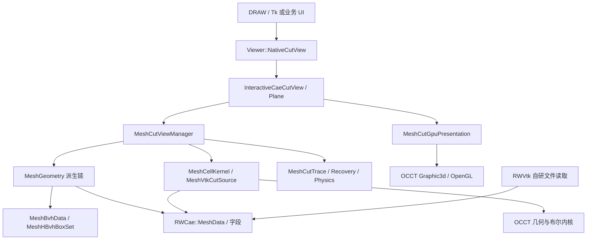
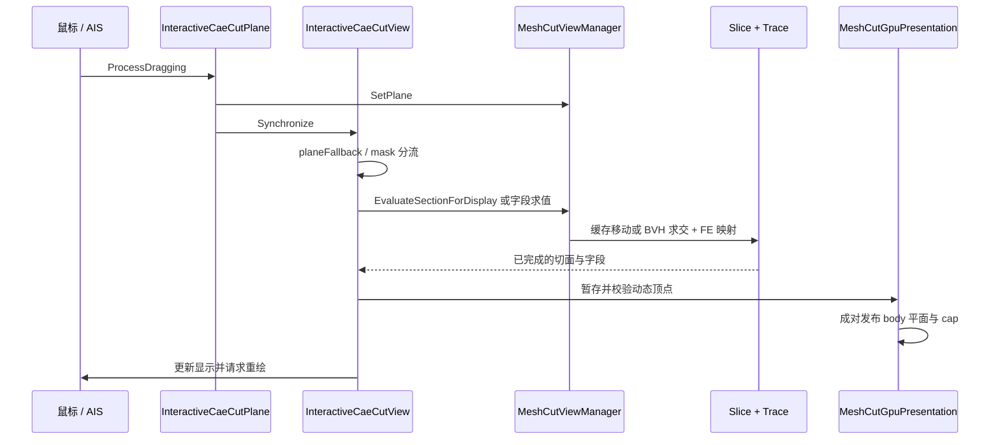

# Cut View Manager：架构、设计、算法与迁移基础

## 1. 目标、基线与结论

本指南供一个没有 OCCT、没有本项目单元级 BVH 体系的旧版 VisIt CAE 工具迁移 Cut View Manager 使用。目标已有交互式渲染，但总体处理方式偏静态；迁移的关键是拆开“源数据准备”“每次切面计算”“显示资源更新”，而不是仅增加一个管理面板。

本篇保留 2026-10-14 的架构核对基线。后续 A01–A09 已增加完整平面运动/材料截面、自由体、独立等值面、切片集合、plot 策略、自动来源和视口隔离；当前 session 为 4、definitions 为 13。
最新行为与验收以 [对标台账](cut-view-manager-abaqus-parity.md)、[A10 验收记录](cut-view-manager-acceptance.md) 和 [无 OCCT 手册第 17–24 节](cut-view-manager-visit-porting.md) 为准；下文旧版本说明用于理解演进，不是当前写出格式。

**目标迁移方案已确定完全不使用 OCCT**，包括基础类型、BVH、几何内核、显示及间接运行时依赖。下文 OCCT 内容描述当前源项目，供学习算法与逐项替换；目标约束以 [无 OCCT 迁移手册](cut-view-manager-visit-porting.md) 为准。本项目当前版本的 Linux 直接运行、GDB 调试和测试命令见 [Linux 操作指南](cut-view-manager-linux-run-test.md)。

本项目的高性能单平面方案是：**源模型外表面常驻 GPU，GPU 裁剪保留侧，CPU 计算带有限元来源的切面并补面**。只看切面时隐藏整个源模型；两侧都看时不裁剪实体，只按需计算 slice。球、柱、等值面以及不满足快速路径的显示方式维持各自的 CPU 路径。

核对基线为 2026-10-14 的工作区：

| 项目 | 核对结果 |
| --- | --- |
| OCCTViewer | `D:\workspace\OpenCASCADE\OCCT_Viewer`，`develop`，文档开发起点 `1f10f0a` |
| OCCT | 本机安装头文件标为 7.7.0；`OCCT_private` 核对提交 `db3716c9f`，属于定制分支 |
| 目标工程 | `D:\workspace\visit`，核对提交 `75472ac071`；`src/VERSION` 为 2.3.0 |
| 目标依赖 | 顶层保留旧 Qt4 / VTK 构建逻辑；`bypassEngine` 注明 VTK 7.1.1 兼容；不能据此断言部署包的实际版本 |
| 验证边界 | 阅读代码、图索引查询和已有脚本；本轮没有在 CentOS 上构建或运行目标软件 |

源项目已全量刷新 codebase-memory。C++ Handle、模板、重载及目标 `.C` 源文件存在索引覆盖不足，本文重要行为按源文件复核；图中同名函数误匹配不作为证据。源代码链接以相对路径提供，迁移前应固定双方提交。

配套文档：[OCCT 功能清单](cut-view-manager-occt-api-inventory.md)、[VisIt 实施手册](cut-view-manager-visit-porting.md)。

## 2. 先建立正确的功能模型

### 2.1 Clip、Slice 与 Manager 的区别

平面统一表示为 `f(x)=n·x+d`，其中 `|n|=1`。Negative 为 `f<0`，Positive 为 `f>0`，On 为切面。用户输入 `A B C D` 后须将四个系数一起除以法向长度；不能只归一化前三项。

- **Clip**：输出保留侧的几何或其边界；GPU clip 只改变可见性，不产生新的体单元。
- **Slice**：体单元与切面的交集，通常是三角形、四边形或多边形；二维输入可能得到线，线输入可能得到点。
- **Manager**：维护多个定义、独立求值、字段、可见性、变形、来源、缓存、撤销和分析。
- **封盖 cap**：在单侧实体截断处显示 CPU 切面，视觉上闭合实体；它不能替代真实裁剪后的体单元数据。

本项目多个 cut 是**从同一源数据出发的独立分支**。显示可将分支做 OR；它不等于按 X→Y→Z 连续裁剪的交集。目标若保留旧 Clip operator 的连续裁剪语义，需作为不同模式，不能借相同按钮悄悄改变定义。

### 2.2 三位显示掩码

定义在 [MeshCutViewManager.h](../source/ViewCaeGeom/MeshCutViewManager.h)：Negative=1，On=2，Positive=4。

| mask | 显示意图 | 单平面 GPU 路径的主要工作 |
| --- | --- | --- |
| 0 | 全隐藏 | 不计算不可见 slice |
| 1 | 负侧实体 | 裁剪 body；按负侧实体闭合规则生成 cap |
| 2 | 仅切面 | 隐藏 / 断开 body，只显示 CPU slice |
| 3 | 负侧＋切面 | GPU 保留负侧，CPU slice / cap |
| 4 | 正侧实体 | 裁剪 body；按正侧实体闭合规则生成 cap |
| 5 | 两侧实体 | body 不裁剪，不额外计算显示 slice |
| 6 | 正侧＋切面 | GPU 保留正侧，CPU slice / cap |
| 7 | 两侧实体＋切面 | body 不裁剪，CPU slice 按需更新 |

On 位控制独立切面显示，但单侧实体的闭合还有自身规则，因此不能简单用 `mask&2` 判断一切切面工作。两侧不透明实体会通过深度测试遮挡内部 slice；mask=7 并不承诺透视内部的 X-ray 效果。

## 3. 模块架构与阅读地图



| 层 | 主要源文件 | 迁移责任 |
| --- | --- | --- |
| 数据 | [MeshData.h](../source/RWCae/MeshData.h)、[MeshElement.h](../source/RWCae/MeshElement.h)、[MeshNVecProperty.h](../source/RWCae/MeshNVecProperty.h) | 坐标、拓扑、原始编号、字段中心、时间步 |
| 文件 | [RWVtk](../source/RWVtk) | 自研 legacy/XML VTK、VTU 等读取，不依赖外部 VTK SDK |
| 调度 | [MeshCutViewManager.cpp](../source/ViewCaeGeom/MeshCutViewManager.cpp) | 定义、求值分流、缓存与 epoch |
| 原生计算 | [MeshGeometrySlice.cpp](../source/ViewCaeGeom/MeshGeometrySlice.cpp)、[MeshGeometryClip.cpp](../source/ViewCaeGeom/MeshGeometryClip.cpp)、[MeshGeometryIso.cpp](../source/ViewCaeGeom/MeshGeometryIso.cpp) | 切面、保留侧、等值面、拓扑和插值 |
| 空间加速 | [MeshBvhData.cpp](../source/ViewCaeGeom/MeshBvhData.cpp)、[MeshHBvhBoxSet.h](../source/ViewCaeGeom/MeshHBvhBoxSet.h) | 空间与标量 BVH、两级遍历 |
| 通用 FE | [MeshCellKernel.cpp](../source/ViewCaeGeom/MeshCellKernel.cpp)、[MeshVtkCell.cpp](../source/ViewCaeGeom/MeshVtkCell.cpp) | 参考单元、形函数、导数、逆映射 |
| 通用求交 | [MeshVtkCutSource.cpp](../source/ViewCaeGeom/MeshVtkCutSource.cpp)、[MeshGeometryVtkCut.cpp](../source/ViewCaeGeom/MeshGeometryVtkCut.cpp)、[MeshVtkAnalytic.cpp](../source/ViewCaeGeom/MeshVtkAnalytic.cpp) | 曲边、高阶、任意单元边界与 OCCT 适配 |
| 来源与物理 | [MeshCutTrace.cpp](../source/ViewCaeGeom/MeshCutTrace.cpp)、[MeshCutPhysics.cpp](../source/ViewCaeGeom/MeshCutPhysics.cpp)、[MeshCutIntegration.cpp](../source/ViewCaeGeom/MeshCutIntegration.cpp) | 原单元 / 节点权重、界面选择、截面分析 |
| 显示 | [InteractiveCaeCutView.cpp](../source/ViewCae/InteractiveCaeCutView.cpp)、[MeshCutGpuPresentation.cpp](../source/ViewCae/MeshCutGpuPresentation.cpp) | AIS 生命周期、GPU body、动态 slice、拾取 |
| 应用接口 | [NativeCutView.h](../source/Viewer/NativeCutView.h)、[NativeCutTimeline.cpp](../source/Viewer/NativeCutTimeline.cpp)、[NativeCutSession.cpp](../source/Viewer/NativeCutSession.cpp) | 编辑事务、时间步、会话和 CAD |
| 宿主适配 | [CutViewCommands.cpp](../source-draw/ViewCaeTest/CutViewCommands.cpp)、[cut_view_manager.tcl](../test/cae/cut_view_manager.tcl) | DRAW 命令、Tk 面板，不承担 FE 内核职责 |

迁移最小阅读顺序：定义头文件 → `Evaluate` / `evaluate` → `Synchronize` → `planeFallback` → `MeshGeometrySlice` → GPU `Update` → Trace → Physics。之后再学习 BRep 通用路径和会话。

## 4. 数据契约：迁移必须先对齐的基础

### 4.1 源网格不等于显示三角网格

`MeshData` 继承 `Poly_Triangulation`，但实际还保存：float 节点、按类型紧凑存储的元素、原始输入顺序的 `IndexedElement{Type,Index}`、通用单元完整连接关系 / 面 / 阶次 / 有理权重、字段及 block。不能只复制继承类的三角形数组。

目标建议保留原生 double 坐标，显示阶段才转局部 float。源项目以 float 存坐标是当前实现的精度边界；用 double 重建交点不能恢复读入时已经丢掉的坐标精度。

每个源单元至少可查询：

```text
dataset identity + geometry epoch + time step
domain / block / material / ownership / ghost flags
original element ID + cell type + local connectivity
original node IDs + coordinates + optional displacement
field name + centering + components + units + layout
```

目标中的 `vtkIdType`、求解器 ID、domain 内 index 与本项目 `MeshEntityId` 不能默认相同。局部连续 index 用于数组寻址；稳定原始 ID 用于查询、跨域去重、会话和报告。建议稳定 ID 用 64 位，显式保存映射和溢出检查。

### 4.2 结果必须保留有限元来源

`MeshGeometry` 通过节点、元素映射递归关联父几何；`MeshInterpolatedNode` 保存原始节点的稀疏权重。几何位置和字段值共享来源：

```text
x = Σ wi xi
q = Σ wi qi                    节点字段
q = q(originalElement)         单元常量字段
```

线性原边上的交点只需要两个权重；高阶单元须使用其形函数。不得把高阶节点按到点距离加权，或拿离交点最近的原节点作为物理插值。

建议迁移时增加独立 provenance 表：图元→原单元与参考坐标，顶点→原节点权重；可由显示顶点复制、多材质边界及高阶细分共享。显示顶点合并不应破坏两侧不同的物理 owner。

### 4.3 结果的生命周期

`MeshCutResult` 包含三个 `Portions`、显示 `Fields`、独立 `PhysicalFields` / `PhysicalProvenance`、面积体积及近似诊断。

- 当前结果在 manager 下一次更新前有效，内部几何可能原地更新；它不是不可变快照。
- `BoundaryMesh=true` 表示边界输出，不能当作重新划分后的完整体网格。
- `PresentationOnly=true` 表示显示 OR 结果，不能直接作为物理积分输入。
- `DisplayRecovered` 和 `TensorDerived` 说明显示值已经恢复或派生；物理分析仍应读原始物理分量。
- `SourceApproximate`、残差、细分层数和预算信息应随结果导出，不能仅在调试窗口显示。

异步迁移版本须增加真正的不可变结果包，或者将结果深拷贝到独立缓冲区；把当前 handle 放到后台队列并不自动安全。

## 5. 一次平面拖动的实际调用链



应用层入口 `NativeCutView::Refresh` 执行同步及显示更新；满足 GPU 路径时更新驻留表示，CPU 路径则按需 Redisplay。`NativeCutView::BeginDrag` 保存定义 JSON，`EndDrag(true/false)` 提交或恢复。面板约 150ms 的轮询在活动拖动中不再重复求交。

底层有分块并行，但目前 **manager / cache / OCCT 显示发布仍属于 Viewer 线程**。已有取消 token 和 generation 不代表已经实现后台 latest-request worker；目标线程架构见实施手册。

## 6. BVH：从零实现时的工程细节

### 6.1 两种加速结构与两种空间

`MeshBvhData` 管理原生网格的三维空间 float 包围盒，以及标量切割的一维 double 值域。`MeshHBvhBoxSet` 是两层 box set：下层按子集保存单元，上层保存子集包围盒；使用 OCCT BVH 构建、遍历接口，并行构建下层。

`MeshVtkCutSource` 则维护通用单元的独立 double BVH，并缓存后续 BRep 所需信息。AIS 拾取、Graphic3d structure / layer 的选择加速是另一套体系；替代 FE BVH 时不能只移植鼠标拾取 BVH。

目标 VisIt 的 domain interval tree 可作为上层筛选，但每个大 domain 内仍需单元级结构。若几百万个 hex 全在一个 domain，只有 domain bounds 几乎没有效果。

### 6.2 平面与 AABB 相交

对盒中心 `c`、半径向量 `e=(max-min)/2`：

```text
s = n·c + d
r = |nx| ex + |ny| ey + |nz| ez
s-r > tolerance       整盒在正侧
s+r < -tolerance      整盒在负侧
否则                  与平面相交或临界，继续遍历
```

只求 slice 时可丢弃两种完全单侧盒；求保留侧时完全在保留半空间的盒还可整体接受。BVH 判定必须保守：允许多收候选，不能漏掉实际相交单元。float bounds 从 double 转换应向外扩张；非有限数据应报告错误或明确屏蔽，不能进入排序键。

### 6.3 建树和遍历的可实现方案

下面是**无 OCCT 时的建议实现**，不是声称当前源项目逐项采用：

1. 以源单元完整边界构造 AABB；线性凸单元可取角点，高阶曲边不能只取角点且声称保守。
2. 每个 domain / partition 建树；首版可按最长轴质心中位数二分，叶子容纳 8–16 个单元。
3. 平面拖动不改变盒子，重复使用树；同一 normal 的平移还可缓存投影区间。
4. 采用连续 `Node{min,max,left,right,first,count}` 和连续 cell ID 数组，避免每节点 heap 分配。
5. 栈式或显式 stack 遍历输出候选；每 worker 独享输出 vector，最后归并。
6. 只有证据表明建树成为瓶颈时再做 Morton/LBVH 或 SAH；先保留可比较的串行正确性基准。

首版测试将候选集与全扫描 oracle 比较，要求所有真实相交单元都包含在候选中。扫描只用于正确性回归，百万单元交互性能必须测试真实 BVH 路径。

### 6.4 重建、refit 与失效

| 变化 | 源空间 BVH | 标量值域 | 切面拓扑 / 字段 / 显示 |
| --- | --- | --- | --- |
| 平面位移 / 转动 | 保留 | 保留 | 位移尝试拓扑复用；转动通常重求交 |
| 换颜色表 / 图例范围 | 保留 | 保留 | 更新颜色 / UV，不改 FE 来源 |
| 换显示字段 | 保留 | 仅当它是 iso 切割字段才影响 | 重算显示字段和相关恢复 |
| 节点原地变化 | 失效 | 视切割字段而定 | `InvalidateGeometry`，重建相关几何 |
| 位移场 / 变形比例变化 | 失效 | 标量数据不必总重建 | 变形几何、trace 和 body 失效 |
| 新网格 / 连接关系 / domain 重分区 | 重建 | 重建 | 清理全部来源关联 |

本项目以源 / 字段 epoch 显式失效。目标可增加 refit，但这是扩展工作：重算叶盒并自底向上合并；强变形造成候选比例升高时再重建。曲边 conservative bounds、ghost ownership 和时间步也须纳入 key。

## 7. 原生单平面切面算法

### 7.1 通用轮廓路径

`MeshGeometrySlice` 从 BVH 获取候选单元，计算顶点的有符号值，依据拓扑边和 contour 表产生交点与图元。生成节点记录原边插值，生成单元记录源元素。多个单元共享同一源边时复用来源键，避免重复顶点及接缝。

核心求交为：

```text
fa = n·a + d; fb = n·b + d
t = fa / (fa-fb)
p = (1-t)a + t b
w = {(nodeA,1-t),(nodeB,t)}
```

先将端点按稳定原 ID 排序，以统一方向计算 t；共享键是原始边的无向 ID 对。源代码原生路径使用两个 32 位 ID 的紧凑键；目标 64 位编号必须用 pair / struct hash，不能继续左移 32 位后截断。

在平面过原顶点、共面边 / 面、重复节点、退化单元时走现有轮廓处理。几何容差不等于字段容差，也不等于物理插值权重的裁剪阈值。

### 7.2 仿射六面体快速路径

百万级规则 hex 的热点被专门处理：

1. 由 `p1-p0`、`p3-p0`、`p4-p0` 建三基向量，检查其余角点满足仿射关系与 Jacobian 非退化。
2. 检查 12 条原边，计算交点，按原节点来源统一方向。
3. 围绕截面中心建立平面内坐标，用 `atan2` 排序构成凸多边形。
4. 输出三角形、四边形或多边形及来源，后续按显示需求三角化。
5. warped hex、近原节点、近边端点或不满足快路条件的单元回退。

当前代码含 `1e-5` 的近零判断、靠近端点约 `0.001 / 0.999` 的保护及其他有效性检查。这些是已有实现的条件，不是适合所有模型尺寸的通用 FE 精度指标。迁移时必须结合单位、坐标量级、最小边长和源存储精度校准。

### 7.3 并行边界

大网格先对候选单元分块，每块 4096 单元，通过 `OSD_ThreadPool::Launcher` 使用最多四个池 worker 执行准备和切割。worker 产出局部记录，调用线程确定性归并共享边、节点与图元。

未变形节点的准备可在 worker 中进行；变形后 touched-node 缓存等可变状态先在调用线程准备快照。不要并发访问隐藏的惰性 mesh cache、共用 map、BRep builder 或显示 context。线程数是当前策略，不是 CentOS 目标的最优值。

### 7.4 同法向平移的拓扑复用

`MeshCutViewManager::moveCachedPlane` 的思想：对固定 n，只有平面越过源节点投影 `n·x` 时单元交边拓扑才可能变化。在严格安全区间中保留 connectivity，只更新原边上的 t、位置、trace 权重及字段。

当前实现检查不变法向、允许的一阶凸单元拓扑、排序后的精确源投影区间，并在修改前验证全部边权重。大于等于 65536 节点时，以 8192 节点分块并行计算 / 排序，再 exact unique / set_union。它没有用量化桶放宽安全区间。

迁移步骤：先记录每个交点的源边；平移时完整验证，再一次性发布；跨区间或接近顶点就正常重切。不能仅因“鼠标移动很小”而复用拓扑，也不能让验证中途失败留下半更新网格。

## 8. 通用单元、高阶、曲面和等值面

### 8.1 名称中 Vtk 的真实含义

`MeshVtkCell`、`MeshGeometryVtkCut` 等表示兼容 VTK 单元语义，计算内核是本项目自己的 `MeshCellKernel`。当前 CMake 不查找外部 VTK SDK，历史 `OCCTV_USE_VTK` 参数已经不参与依赖选择。

目标 VisIt 本来使用 VTK，可直接接其数据而不迁移文件读取层；不要为了复用这套自研算法再引入另一个 VTK 版本。

### 8.2 FE 内核和逆映射

`MeshCellKernel` 提供参考拓扑、节点次序、形函数及导数，包含部分 Lagrange / Bernstein / rational 图表。给定参考坐标 ξ：

```text
x(ξ) = Σ Ni(ξ) xi
q(ξ) = Σ Ni(ξ) qi
J(ξ) = ∂x/∂ξ
J Δξ = xTarget - x(ξ)
```

逆映射迭代中使用 `math_Gauss` 解线性系统，并结合残差 / 参数域等有效性检查。输出离散三角形只是几何采样，取值应回到原 FE chart。迁移时先列单元支持矩阵：类型、阶次、节点顺序、曲边、rational 权重、导数、逆映射、是否允许退化；未知类型显式拒绝或标记近似。

[MeshCellTopology.h](../source/RWCae/MeshCellTopology.h) 当前按文件格式 ID 识别以下类型，完全不需要外部 VTK SDK：

| 维数 | 已识别的 cell type ID |
| --- | --- |
| 0 | 0、1、2 |
| 1 | 3、4、21、35、68、75 |
| 2 | 5、6、7、8、9、22、23、28、30、34、36、69、70、76、77 |
| 3 | 10、11、12、13、14、15、16、24、25、26、27、29、31、32、33、37、41、42、71、72、73、78、79、80 |

常见线性 tet / voxel / hex / wedge / pyramid 分别是 10 / 11 / 12 / 13 / 14；68–73 与 75–80 对应实现中的 Lagrange / Bezier 家族。必须注意：**识别格式、节点数验证、FE 求值、解析转换、iso 与 GPU 支持是不同能力**。表中出现不代表所有算法都精确支持；`ValidSize`、`MeshCellKernel::prepare`、`MeshVtkAnalytic` 及对应测试共同决定完整能力。节点数 / 阶次或 polyhedron face stream 不一致时应先拒绝，不能进入布尔后再补救。

### 8.3 OCCT 通用几何路径

这条路径用于需要通用单元边界 / 曲面的场景，不应当成为规则百万 hex 拖动的默认实现。

1. `MeshVtkCutSource::Prepare` 准备源单元边界、共享面关系、误差和预算信息，建立 double BVH。
2. 单元按需构造 OCCT shape；支持的参数图表优先转 Bezier 曲面 / 曲线，其他按容差细分。
3. 校验公共面；当前源码对体单元曲面使用共同细分层级以减少 T-junction，代价是可能增加整体内存。
4. 平面使用半空间，球使用球体，柱使用覆盖源范围并带 padding 的有限柱工具。
5. `BRepAlgoAPI_Common / Cut / Section` 完成相交；利用 `Modified(face)` 等历史过滤内部面。
6. `BRepGProp` 求面积 / 体积；`BRepMesh_IncrementalMesh` 离散；读取三角形时应用 face location 和 orientation。
7. 重新定位到原 FE 单元，生成物理来源及字段，而非直接相信 BRep 三角点具有 FE 数据。

圆柱工具的端面不是无限柱切面；代码选取侧壁并按源范围构造工具。移植时要保留范围外推、端面排除和有效性检查。

`MeshVtkAnalytic` 当前对支持的、最高到六阶的参数图表进行 Bezier 转换，并检查正权重与转换残差；这不等于所有高阶单元都能精确解析。几何模式 `Numerical / AnalyticPreferred / AnalyticRequired` 必须保留失败策略。

### 8.4 球、柱与等值面

曲面简单单元可走 `MeshGeometryQuadric`，通用单元走相应后端。GPU 平面优化不改变这些 cut 的计算语义。

Iso 的切割字段独立于显示字段，并以名称、中心类型、原分量、时间步和值绑定。单元字段阈值先等权投影到节点；需要让用户知道这改变了单元常量阈值的解释。

高阶 iso 按参数域单纯形细分，检查字段和几何残差，并受最小层级、最大层级、图元预算约束。当前契约是**有预算的采样数值近似**，不是证明区间内所有根都被隔离；很薄的特征和内部闭合零集必须通过专门算例验收。

## 9. 字段、界面 trace 与物理计算

### 9.1 显示插值和物理来源分离

节点字段由原 FE 权重插值。单元字段可保持 constant，或投影用于连续显示；恢复、区域限制、张量不变量是显示策略，不能覆盖求解器原始值。

一个几何位置可能来自多个材料 / 原单元。`MeshCutTrace` 支持 Lowest、Negative、Positive、Region 等 owner 选择，并分别配置 display 与 physical trace。材料接口上的应力可能不连续；同坐标不意味着同物理节点。拾取与报告应返回 cut ID、portion、源 domain / element、权重和 trace 策略。

`MeshCutRecovery` 控制跨单元平均阈值与区域边界；`MeshCutTensor` 处理张量分量布局、tensor / engineering 约定、Mises、主值等。迁移前必须明确 `xx yy zz xy xz yz` 等布局和剪切应变是否带 2 倍关系。

### 9.2 截面分析

三维应力牵引和截面力矩：

```text
t(x) = σ(x) n(x)
F = ∫S t dA
M = ∫S (x-x0) × t dA
Q = ∫S q·n dA
```

`MeshCutPhysics` / `MeshCutIntegration` 使用来源和物理字段；线性节点场的 force / moment 路径用二阶三角形求积。曲面上的法向随位置变化；球 / 柱有解析法向，iso 法向则需明确输入与约定。

必须固定：法向方向、负侧自由体 / 正侧自由体、积分点字段、坐标系、单位、参考点、无效值处理和残差。改变法向时应验证力和通量符号；坐标原点平移时力不变，力矩按平移关系变化。

壳、梁、复合材料层合应力不能当作普通三维实体张量直接积分；需要厚度、局部基、层位置和 section resultant 适配。自动 crack / density 功能也要求显式字段映射，不靠字段名猜测。

### 9.3 显示 OR 与分析隔离

`MeshCutUnion` 生成可见区域的边界组合并处理交叠；它用于表示，并不证明所有内部图元可无重叠积分。物理分析针对独立 cut 的原始 trace；多截面累加或材料分区须有明确 owner、去重和积分域定义。

## 10. GPU 实体裁剪＋CPU 切面

### 10.1 进入快速路径的条件

`InteractiveCaeCutView::planeFallback` 要求：一个启用的 plane、纯体网格、无向量图、不透明，三个 portion 统一使用 FlatShaded / MeshEdges / ShadedMeshEdges。两侧线框的线宽也须相同。否则回到已有 CPU 表示，并报告原因：

```text
requested_cpu / multiple_cuts / no_active_cut / non_plane_cut
vectors / non_volume_mesh / transparent_style / display_mode
mixed_display_modes / mixed_line_widths
```

不要将“选择 auto”当作 GPU 必然启用；迁移诊断面板应显示实际 backend 和 fallback reason。GPU 裁剪不会消除 CPU 上的 BVH 遍历、切面拓扑、字段、trace、选择更新和上传。

### 10.2 资源分离

| 资源 | 内容 | 更新时机 |
| --- | --- | --- |
| body | 源模型外表面三角形和/或单元边线、法向、源字段 UV | 初次显示、模式切换、网格 / 变形 epoch 改变；单纯平面移动不重建 |
| plane uniform | 局部平面、模式、颜色 | 每次有效平面请求 |
| slice / cap | CPU 截面三角形和/或多边形周边线的位置、法向、UV | 平面 / 切割字段变化；只上传切面规模数据 |
| legend / style | 范围、纹理、标注 | 独立更新；不应触发全模型几何重建 |
| selection | body owner、动态 cap 来源 | 分别按源 epoch / 切面 revision 更新 |

源外表面可以通过面邻接提取：面顶点原 ID 排序构成拓扑键，两相邻体单元共享面为内部面；跨 domain 必须识别 ghost 和邻接，不能把 domain 接口当外皮。高阶面还需校验曲面一致性。只渲染源外皮不等于丢弃内部 FE 连接关系，CPU slice 仍读取体网格。

### 10.3 实际使用的是自定义 shader

`MeshCutGpuPresentation` 通过 `Graphic3d_ShaderProgram / ShaderObject` 写入 `CutPlane`、`CutMode` 等，片元按 side 丢弃。源码创建的 `Graphic3d_ClipPlane` 设置 `SetOn(false)`、`SetCapping(false)`；注释说明连接子结构的实例裁剪状态不适合这里的表示方式。

因此不能将本实现描述成“打开 OCCT 自动 clipping+capping 即完成”。目标可以复用其已有 mapper clip planes，但语义、缓存更新与补面仍需自行接入。

线框同样使用 shader 的平面 discard，源体边线常驻；截面边线来自求交多边形周边，不含扇形三角化对角线。叠加模式使用填充面的 polygon offset 减少边线闪烁。具体显示语义、CPU 合并网格的边线差异及可执行 Tcl 见 [三种显示模式指南](cut-view-manager-display-modes.md)。

### 10.4 动态缓冲区与发布

切面暂存数组保存 interleaved 顶点；容量不足才重建 triangle array，容量足够时 memcpy 并局部 invalidate。identity index 初始化后复用，计数变化才触发必要的 index invalidation；空结果也要传播绘制计数变为零。body 字段 UV 可单独失效，避免更新 positions。

已有实现利用 `Graphic3d_AttribBuffer`、`Graphic3d_MutableIndexBuffer`、mutable array flags，保留 body structure，修改 group bounds 并通知相关显示空间结构。目标若使用自己的 VBO，需对应实现 buffer capacity、有效 count、dirty range、bounds 和资源释放。

所有可能失败的求交、来源重建和分配先完成，再成对发布 body plane 与 cap。若先更新 GPU 平面，后更新 CPU cap，视觉上会出现瞬态缺口；失败时还可能永久错位。每个可见帧应记录同一 generation。

## 11. Clip 与 Slice 接缝：排查和验收

### 11.1 坐标一致性优先于偏置

本项目取源 bounds 中心附近作为局部 origin，body / cap 统一转成局部 float；cap 先按 FE 来源以 double 重建再转局部。令 `x=origin+xLocal`：

```text
n·x + d = n·xLocal + (d+n·origin)
dLocal = d+n·origin
```

实体、cap 和裁剪公式必须共享同一个 origin、坐标系、变形和 normalized plane。在 GPU 中减掉 origin 与 CPU 预减 origin 不能重复做两次。

若显示有模型矩阵 `xWorld=M xModel`，平面作为齐次协向量变换；世界平面转 model 用 `pModel=M^T pWorld`，model 转 world 用 `pWorld=M^-T pModel`。法向不能当作普通点差进行任意非均匀缩放。目标旧 mapper 恰有基于 origin / point 的转换，应专项验证。

### 11.2 将缝分成可定位的问题

| 现象 | 优先检查 | 修复方向 |
| --- | --- | --- |
| 整条边稳定分离 | 平面 / 坐标 / 变形不一致 | 对比同 generation 的 world、local plane 与节点 |
| 大坐标下变坏 | float 精度、不同原点 | 统一局部坐标；记录源存储分辨率 |
| 个别单元裂纹 | 共享边方向 / key、T-junction | 来源键统一、共面规则、共享高阶面细分 |
| 拖动中闪缝，停下消失 | body 与 slice 不同帧 | 完成后成对发布；丢弃过期结果 |
| 叠面闪烁 | 深度竞争、重复 cap | 去重与 draw order，必要时有限 polygon offset |
| 界面颜色断开 | 物理 trace 不同或色阶不同 | 先判断是否真实材料不连续，避免错误焊接 |

统一加 epsilon 可能掩盖方向错误、切掉薄特征或污染物理位置；bias 若确实用于显示，应和物理几何 / 积分彻底分开，并说明尺度及适用范围。

已有 [cut_view_gpu_plane.tcl](../test/cae/cut_view_gpu_plane.tcl) 检查偏移到 1e5 / 1e6、不同法向、掩码、变形和空截面等。它是定点回归证据，不能证明任意曲边模型无缝。迁移验收还应增加非均匀缩放、极小特征、跨 domain 和 ghost 边界。

## 12. 变形、坐标、时间步与会话

变形使用 `x'=x+effectiveScale*u`，本项目 effectiveScale 通过 `MeshTools::ComputeVectorTrsfRatio` 跟随模型尺寸归一化约定，不能直接把 UI 值当物理放大倍数。已有 modifier 对 NaN 位移有处理；目标需统一缺失值与非有限值策略并记录采用的比例。

`MeshCutFrame` 描述局部基，切面和张量变换应明确参考 / 当前构形。路径切面通过平行运输等方式保持朝向连续；`MeshCutSlicing` 支持 regular、range、rotational、path。正交基退化、路径重复点和突然反向要显式处理。

`NativeCutTimeline` 管理时间、帧绑定与播放；时间步切换必须让网格、显示字段、位移和分析输入形成同一个有效状态。不要让旧步 cap 覆盖新步 body。

`NativeCutSession` 当前使用 v3 JSON、冻结源 bundle 及 SHA256 身份验证，先暂存后发布；CAD 形体独立复制和保存。目标应保留模型 identity、cut 定义、字段绑定、单位、局部基、分析请求、时间和可视配置。GPU buffer、裸指针、瞬时 cell index 不应作为跨运行会话标识。

CAD section 是 `BRepBuilderAPI_Copy` / `BRepAlgoAPI_Section` 的独立分支，可与 view-global clip 同步；标注使用 `AIS_TextLabel`。目标没有 CAD 几何内核时可后置此功能，不能拿 FE slice 冒充精确 CAD section。

## 13. 缓存、内存与性能定位

`MeshCutCache` 按 source / result 保守估算预留，结果和渲染器持有 lease 时继续计费。默认策略为 source 4GiB、result 16GiB；这是逻辑预算，不是实际 RSS 限制，也不是部署内存要求。目标首版应根据机器设定策略，并统计峰值和失败原因。

缓存至少分开：source connectivity、空间 BVH、标量 BVH、单元 chart / shape、切面 topology、source trace、映射字段、body display、动态 cap、selection。key 包含相关 identity / epoch / definition，不能以 field name 或裸地址替代版本。

帧耗时应分解为：

```text
输入 / 排队 → 源准备 → BVH → touched nodes → cell cut → merge
→ trace origins / classify / prepare / maps / fill
→ FE field → presentation staging → upload → draw / frame completion
```

源项目的 `MeshCutFrameTimings` 和 `renderinfo` 已提供其中多项。`submitted_body_bytes` 是应用逻辑提交字节，不等于驱动实际 GPU 总线流量。要验证真实 VBO 更新需图形 API 捕获；捕获过程和最终计时分开。

优化优先顺序：确认 Release 无 GDB → 确认实际 GPU backend → 排除整模重建 / 重传 → 检查重复 Synchronize → 区分首次建树与 warm drag → 定位 trace / FE / merge → 再调整并行和缓存。不能在 BVH 已快时继续只优化求交。

### 13.1 百万单元基线与已知边界

当前生成器的 150³ hex 数据含 3,375,000 单元、3,442,951 节点；节点温度为 `x+2y+3z`，另有单元压力和可选仿射位移。

此前本机 Release、无调试器、真实鼠标路由的 60 帧记录中，mask=2 约 31FPS，mask=3 / 7 约 30FPS，p95 约 58–65ms；变形全帧 p95 仍约 72–85ms。它们用于解释已有优化效果，**不是本次重测，也不构成目标 CentOS 的性能承诺**。

本机现存证据为 `build/mingw-release/test/native/draw-benchmark-hex_150.vtu-{2,3,7}-auto-cpu-large-pointer-r6/drag.csv`，分别可复算出 31.35 / 29.62 / 29.65FPS；目录中的 `cpu-large` 是历史场景名，实际 backend 以输出为准。变形记录在 `build/mingw-release/cut-full-frame-hex_150.vtu-2-auto-cpu-large-r7.log` 与 `r8.log`。这些构建产物不随文档提交，迁移验收应重新生成并归档自己的原始数据。

用户已确认一次显著的 2.3FPS 现象来自 GDB 开销。仍需分别记录驱动、硬件、分辨率、同步模式、模型、backend、变形和 debug 状态。视口 FPS 可能包含空闲时间，与连续事件处理吞吐量不同。

## 14. 当前项目的可运行入口

### 14.1 DRAW 中打开百万单元模型

先在独立 Release DRAW 进程中执行；不要把下列 Tcl 直接当 PowerShell 运行：

```tcl
source D:/workspace/OpenCASCADE/OCCT_Viewer/test/cae/viewdraw_runtime.tcl
set ::vtk_cut_demo_file D:/workspace/OpenCASCADE/OCCT_Viewer/build/large-vtk/hex_150.vtu
source D:/workspace/OpenCASCADE/OCCT_Viewer/test/cae/cut_view_vtk_demo.tcl
scvcutview cut_view_vtk_demo visibility x 3
scvcutview cut_view_vtk_demo renderbackend auto
scvcutview cut_view_vtk_demo renderinfo
vrenderparams -perfCounters fps -perfUpdateInterval 0.5
```

`cut_view_vtk_demo.tcl` 会创建 manager、默认平面、节点字段、显示和手柄。仅切面改为 mask=2，两侧加 slice 改为 mask=7。关闭旧窗口后不要复用已卸载的模型 handle。

若缺少数据，在仓库根目录的 PowerShell 执行：

```powershell
python test/generate-large-vtk.py --grids 150 --formats vtk vtu --deformation
```

首次生成 / 读取包含明显 I/O 和源准备开销，不能计入 warm drag 后宣称持续帧率。

`libViewDraw.dll` 加载失败应先检查生成的 `viewdraw-runtime.tcl`、插件路径和依赖 DLL，不应据此判断算法卡住。`viewdraw_runtime.tcl` 负责配置查找路径；它与 Linux 目标迁移没有运行时依赖关系。

### 14.2 C++ 当前接口最小计算示例

下面使用已有类型，假定调用方已经得到有效 `MeshData`，省略异常边界与构建配置：

```cpp
#include <ViewCaeGeom/MeshCutViewManager.h>

ViewCaeGeom::MeshCutViewManager manager(mesh);
if (!manager.AddPlane("section", Graphic3d_Vec4d(1, 0, 0, -0.5)))
    throw std::runtime_error("invalid or duplicate plane");
manager.SetVisibility("section", 2);
auto section = manager.EvaluateSectionForDisplay("section", nodalField);
// 消费 section.Portions[1] 和 section.Fields[1]；下一次更新前有效。
```

需要当前 OCCT 视口时使用 `Viewer::NativeCutView`：`Attach(context,view)` → `Edit(definition)` → `BindField(binding)` → `Refresh()` → `ShowHandle(id,true)`；用 `LastError()` 处理返回 false。若只移植到 VisIt renderer，则替换该显示门面，复用计算 / 来源语义。

## 15. 回归与迁移验收

当前仓库已有 `test/native` 的 CTest 用例，以及 `test/cae/cut_view_*.tcl` 的 DRAW 用例。仓库旧 AGENTS 中“没有 CTest”的说明不能替代当前 CMake：`OCCTV_BUILD_TESTS` 已可启用原生 cut / reader 等测试。

```powershell
cmake -S . -B build/mingw -DOCCTV_BUILD_TESTS=ON
cmake --build build/mingw --parallel
ctest --test-dir build/mingw -N
ctest --test-dir build/mingw --output-on-failure -R "cut_|native_"
```

以上基于已配置的本机 MinGW 构建目录；新环境必须先填写依赖和生成器，不能将 Windows 目录照搬到 Linux。

| 验证层 | 必须证明的性质 | 可参考的现有证据 |
| --- | --- | --- |
| 数值 | 线性场、原单元 ID、权重和、面积 / 体积守恒 | `test/native/CutViewTests.cpp`、`CutPhysicsTests.cpp` |
| 高阶 | chart 次序、曲面残差、预算耗尽行为 | `cut_view_vtk_cells.tcl`、`cut_view_high_order_iso.tcl` |
| 界面 | display / physical trace 独立 | `cut_view_trace.tcl`、`cut_view_recovery.tcl` |
| 显示 | 全掩码、GPU/CPU 一致、无空白接缝 | `cut_view_gpu_plane.tcl`、`cut_view_visual.tcl` |
| 交互 | 一次 move 一次同步、release 不跳变、abort 恢复 | `cut_view_drag_benchmark.tcl` |
| 缓存 | epoch 失效、预算、旧结果不会误发布 | `cut_view_cache.tcl`、`test/native/CutCacheTests.cpp` |
| 业务 | 时间步、物理、会话原子恢复 | `cut_view_time_test.tcl`、`cut_view_session_test.tcl` |

小型解析算例只验证数值与退化处理；性能验收使用百万单元，且测试旋转 / 平移、规则 / 非规则、变形 / 不变形、多个 domain。详细工作包及目标分支改造点见 [VisIt 实施手册](cut-view-manager-visit-porting.md)。

## 16. 迁移时应保留的设计约束

1. 计算层不依赖 Qt、Tk、DRAW 或目标窗口对象；错误和结果通过明确接口输出。
2. 原始 FE 身份、权重、物理字段不能因三角化、恢复或合并而丢失。
3. 平面 GPU 快路与 CPU 分析路径分别验收；显示成功不等于实体数据裁剪成功。
4. 定义、源 / 字段 epoch、缓存、显示 generation 形成可追溯版本；失败保留最后完整有效状态。
5. 本次目标完全不使用 OCCT，需逐项替代其几何 / 基础设施职责；源项目中的 OCCT 依赖不能直接链接或隐藏到目标库中。
6. 目标中已有的数据中心、渲染与交互应通过 adapter 连接；先完成可测的单平面闭环，再扩展全部功能。
