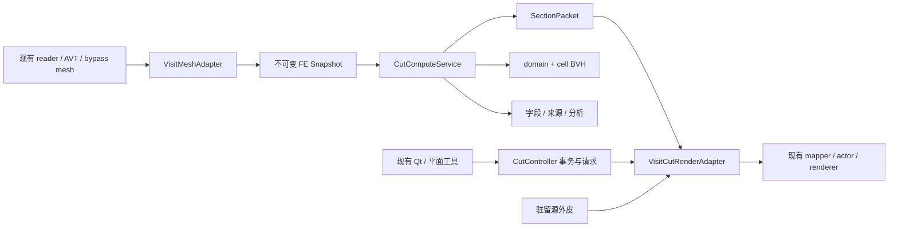

# 将 Cut View Manager 迁移到定制 VisIt：CentOS 7.9、完全不使用 OCCT

## 1. 范围与交付定义

目标是 `D:\workspace\visit` 对应的、已大量修改的 CAE 后处理工具。用户确认其运行在 CentOS 7.9，已有交互式渲染，但处理管线仍偏静态。本轮只读核对目标源码，**没有修改、构建或部署目标工程**。

本手册将“现有源码事实”“迁移建议”“需在部署机核对”分开。它与 [算法架构指南](cut-view-manager-migration-guide.md)、[OCCT 清单](cut-view-manager-occt-api-inventory.md) 一起，构成实施依据。

**本次目标方案明确为：完全不使用 OCCT。** 迁移后继续使用目标已有的 VisIt / VTK / OpenGL 渲染和交互体系，将本项目的 cut 算法、数据契约、来源追踪、缓存及性能设计移植到独立模块。具体约束如下：

- 目标 Cut 模块的头文件、源码和公开接口均不引用 OCCT；不保留 `Handle / Standard_* / gp_* / Graphic3d_* / AIS_* / BRep*` 类型。
- 目标构建和安装不查找、不链接、不打包 OCCT；也不通过间接库、静态库、`dlopen` 或另一个进程调用 OCCT。
- 单元 BVH、平面求交、FE 插值和分析使用自研代码或目标已有能力；曲面 / 高阶 / 布尔功能逐项替换，不能回退到 OCCT。
- OCCT 附录用于理解**源项目中需要替代的职责**，不是目标 SDK 安装清单。源项目当前仍依赖 OCCT，不应把“学习源实现”解释成“原库直接链接即可”。

本项目在 Linux 上的直接运行、GDB 调试和测试命令见 [Linux 运行与测试](cut-view-manager-linux-run-test.md)。那份命令操作当前 OCCTViewer 参考实现，依赖其现有 SDK；它不改变本手册对目标迁移产物的无 OCCT 约束。

完整迁移的交付物应包含：独立计算模块、目标数据 adapter、空间加速、渲染 adapter、交互事务、物理来源、时间 / 会话集成、诊断工具和验收报告。第一阶段只完成单平面闭环，不应在产品中声明所有 cut 已迁移。

## 2. 实际目标分支：已确认与尚未确认

核对提交：`75472ac071`；`src/VERSION` 为 **2.3.0**。这是分支中的版本标记，不代表 fork 仍完全等同上游 2.3.0。`bypassEngine/CMakeLists.txt` 注明兼容 **VTK 7.1.1**，顶层却保留更早的 Qt4 / VTK 构建逻辑；二者必须按实际生产构建区分。

| 已核对源码事实 | 工程含义 | 仍需在运行环境确认 |
| --- | --- | --- |
| 旧 `VisitPlaneTool` 支持连续 / 释放 / 关闭时更新 | 已有可接入的交互阶段 | 定制应用实际使用此工具还是另有 UI |
| `avtSliceFilter` 使用 metadata interval tree 筛 domain | 已有粗层加速可复用 | 生产 reader 是否提供有效 extents |
| 非 rectilinear Slice 分支重置 cell list 后调用 `vtkSlicer` | 原路径没有直接接本项目 cell BVH | 定制过滤器是否另加单元级加速 |
| `vtkVisItOpenGLPolyDataMapper` 含 `glClipPlane`、display lists、MTime 重建判定 | 可以先接 GPU plane，但必须控制几何缓存失效 | 实际 mapper factory、OpenGL profile / 驱动 |
| `vtkVisItDataSetMapper` 按数据类型选择 mapper，非 polydata 可能经 surface filter | 不能只改一种 mapper 就宣称所有输入生效 | 生产 plot / proxy / LOD / remote 渲染路径 |
| `vtkSurfaceFromVolume` 保留 cell data，原 node ID 选最近端点 | 已有 IDs 不足以表达交点的 FE 权重 | solver ID 数组和多分量 ID 的业务含义 |
| `bypassEngine` 可复制 mesh 并挂 scalar，直接交 mapper | 有绕开完整 AVT 管线的接入候选 | 该模块是否被生产主程序使用、在哪个进程持有 mesh |

以下链接面向当前机器的目标源码；文档复制到其他机器后按相同相对源码位置查找：

| 入口 / 职责 | 文件与函数 |
| --- | --- |
| 单切面 operator | [avtSliceFilter.C](D:/workspace/visit/src/operators/Slice/avtSliceFilter.C)：`ModifyContract`、`ExecuteData`、`CanIntersectPlane` |
| 旧 CPU clip | [avtClipFilter.C](D:/workspace/visit/src/operators/Clip/avtClipFilter.C)：`ClipAgainstPlanes`、`ExecuteDataTree` |
| 单域切面内核 | [vtkSlicer.C](D:/workspace/visit/src/visit_vtk/full/vtkSlicer.C)：`SetCellList`、`UnstructuredGridExecute` 等 |
| 交点输出与数据传播 | [vtkSurfaceFromVolume.C](D:/workspace/visit/src/visit_vtk/full/vtkSurfaceFromVolume.C)：`ConstructPolyData` 等 |
| 旧 GL 表示 | [vtkVisItOpenGLPolyDataMapper.C](D:/workspace/visit/src/avt/Plotter/vtk/vtkVisItOpenGLPolyDataMapper.C)：`RenderPiece`、`ReleaseGraphicsResources` |
| 数据类型分流 | [vtkVisItDataSetMapper.C](D:/workspace/visit/src/avt/Plotter/vtk/vtkVisItDataSetMapper.C)：`Render` |
| 平面工具 | [VisitPlaneTool.C](D:/workspace/visit/src/avt/VisWindow/Tools/VisitPlaneTool.C)：`Translate`、`TranslateNormal`、`RotateX/Y`、`CallCallback` |
| 鼠标阶段 | [VisitHotPointInteractor.C](D:/workspace/visit/src/avt/VisWindow/Interactors/VisitHotPointInteractor.C)：开始、移动、结束和 abort |
| 工具到业务 | [avtToolInterface.h](D:/workspace/visit/src/avt/VisWindow/Tools/avtToolInterface.h)：`ExecuteCallback`；[ViewerWindow.C](D:/workspace/visit/src/viewer/main/ViewerWindow.C)：`HandleTool` |
| domain bounds | [avtIntervalTree.C](D:/workspace/visit/src/avt/Pipeline/Data/avtIntervalTree.C) |
| 可选绕行入口 | [AttachDomainVariables.cpp](D:/workspace/visit/bypassEngine/AttachDomainVariables.cpp)、[VisitActiveScalarSemantics.cpp](D:/workspace/visit/bypassEngine/VisitActiveScalarSemantics.cpp) |

目标图索引对 `.C` 文件没有可靠覆盖，以上以实际源代码复核；不能从图里找不到函数就认定生产代码不存在。生产 fork 的 GUI、插件注册和远程引擎组合仍需负责人提供实际启动 / 构建配置完成最后一段调用链。

## 3. 现有流程为何“能交互但偏静态”

### 3.1 原有 operator 路径

`avtSliceFilter::ModifyContract` 从 metadata 获取 spatial extents，调用 interval tree 的平面查询，限制 domain，并添加 `avtPlaneSelection`。这能减少读取 / 分发的 domain，不能保证大单域内部只处理与平面相交的单元。

`ExecuteData` 首先检查 domain bounds；rectilinear 有专门切片 / cell-list 分支，其余输入调用 `vtkSlicer`，并由 VTK `Update` 根据 MTime 执行计算。`vtkSlicer::SetCellList(int*,int)` 已提供候选列表入口；未传列表时其 unstructured 循环遍历全部单元。

Clip 则构造 `vtkVisItClipper`，可能串接多平面，得到新的 unstructured output。每个拖动都更新 operator 属性时，几何、字段、AVT 有效性、传输与 mapper input 都可能重新变化。是否发生整条链重算必须在生产入口埋点，不能仅凭静态阅读估算耗时。

### 3.2 交互工具已有阶段划分

`VisitPlaneTool::Translate` 在 `CB_START` 准备交互，`CB_MIDDLE` 更新变换、文字、outline 并 Render；在 `UPDATE_CONTINUOUS` 才持续 `CallCallback`。结束时根据模式提交回调。`CallCallback` 将 origin / normal / up axis 写入 interface，再 `ExecuteCallback`；它还处理 3D axis scaling。

这允许先将拖动更新导向轻量 controller，而不是每 move 都完整执行 operator 更新。注意现有代码在某些阶段先 Render 再回调，可能多绘一帧；要让 body / cap 更新完成后统一 Render。

### 3.3 渲染缓存已有，但过度失效仍会卡

旧 polydata mapper 将 clip planes 写给 OpenGL，然后以 mapper、input、actor property 的 MTime 和 render window 判断是否重建显示列表。若平面变化通过 mapper 的 MTime 传播，每次 move 仍可能释放并重建整模 display lists。

源码确认了该风险，尚未通过生产二进制证明每次 plane 更新必然发生重建。应插桩记录 `BuildTime`、`GetMTime`、input / property MTime、`ReleaseGraphicsResources` 次数和显示列表创建次数。先让“平面参数变化”与“几何 dirty”分开，才有 GPU clip 的性能收益。

## 4. 确定架构：保留目标渲染，接入无 OCCT 的 Cut 服务



图中模块名为**建议新增模块**，不是当前目标已存在的类。

| 保留 / 新增部分 | 实施要求 | 验收边界 |
| --- | --- | --- |
| 保留 VisIt / VTK renderer 和现有交互 | 接入 body / cap / guide；沿用目标已确认的 VTK SDK | 不嵌入 OCCT 视口，不新增另一套 VTK |
| 新增自研 CutCore | 使用自有数学类型、STL、线程接口、FE 数据和来源结构 | 没有 OCCT include、类型或链接依赖 |
| 新增 cell BVH | 自研连续内存 AABB tree，domain interval tree 作粗层筛选 | 不使用 OCCT BVH 模板或实现作为隐藏依赖 |
| 移植显示 / 物理语义 | mask、trace、字段、变形、积分和 generation 分离 | 不是仅复制 UI 或替换几个类名 |

`RWCae / ViewCaeGeom / ViewCae / Viewer` 当前都有 OCCT 依赖，不能把这些库原样链接进目标，再通过接口隐藏其实现。这里复用的是算法与契约，移植时应重写相应基础设施。先完成线性单平面，再扩展功能；每一阶段都必须满足无 OCCT 的构建和运行约束。

### 4.1 OCCT 职责的强制替换表

| 源项目能力 | 目标落地方式 | 必须验证 |
| --- | --- | --- |
| `Standard_Transient / Handle`、`NCollection_*` | 自有对象生命周期、`unique_ptr / shared_ptr`、连续数组和 STL 容器 | 引用、cache lease、线程和索引起点 |
| `gp_* / Graphic3d_Vec* / Bnd_Box / math_Gauss` | 自研 double 向量 / 矩阵 / plane / bounds、带 pivot 的小型线性解算 | 平面归一化、奇异 / 退化、残差和坐标变换 |
| `BVH_BoxSet / BVH_Traverse / LinearBuilder` | 自研 domain＋cell AABB tree | 保守 bounds、无漏检、重建 / refit 和 epoch |
| `OSD_ThreadPool / Timer / Mutex` | 目标线程池或标准库线程、单调时钟和锁 | worker 独立暂存、取消、异常和确定性归并 |
| `Poly_Triangulation` 及网格类继承 | 独立源 FE 拓扑与切面输出，边界通过 VTK adapter 连接 | 64 位 ID、完整单元连接、稀疏来源权重 |
| BRep 平面 / 球 / 柱求交 | 自研原边 / 参数域求交；必要时使用目标已有 VTK 功能作兼容路径 | 几何与字段误差、共面 / 退化、结果维数 |
| Bezier chart 与高阶曲面处理 | 自研形函数、参数图表、受预算约束的细分和逆映射 | 节点次序、rational 权重、残差和未知类型拒绝 |
| `BRepGProp`、显示 OR / 布尔边界 | 自研截面 / 边界积分、拓扑去重与组合；可适配目标已验证的能力 | 面积 / 体积定义、owner、闭合性和近似误差 |
| `Graphic3d / Prs3d / AIS / V3d` | 目标 mapper / actor / VBO / shader / camera / tool | 驻留 body、动态 cap、拾取过滤和 paired publish |
| BRep CAD section / 会话 | 使用目标实际已有的 CAD 接口；若只有离散表面则提供明确标记的近似交线 | 不把离散切线声明为精确 CAD section；未实现时显式 unsupported |

### 4.2 没有 BRep 内核时如何覆盖后续功能

线性平面直接沿原单元边求交，并建立 FE 权重，不需要 BRep。对于曲边单元，先在参考单元上求形函数和 Jacobian，再对 `f(x(ξ))=0` 做有预算的数值细分 / 求根；节点场通过同一个 `N(ξ)` 插值。sphere / cylinder 使用解析隐式函数，iso 使用原 FE 字段函数，保持几何容差与字段容差分开。

负 / 正侧真实体网格、可见区域 OR、任意非凸 polyhedron、曲面闭合和 CAD 交线比“画一个截面”要求更高。应分别实现和验收，保留现有 VisIt 非平面功能作为兼容路径；若目标已有功能不能满足原项目语义，则报告未实现或数值近似，不能暗中启用 OCCT。GPU clip 只负责显示，不替代真实体分割或物理积分。

## 5. 数据 Adapter：最先落地的工作

### 5.1 从 vtkDataSet 构造稳定快照

建议适配入口放在源 mesh / field 已经准备好、尚未被 Slice / Clip 改写的位置。分别处理 unstructured、rectilinear、structured，不要把规则网格每次展开成几百万个独立 heap cell。

adapter 完成以下操作一次，并按 epoch 复用：

1. 固定数据 identity、time step、domain 和 field metadata；持有输入对象有效引用。
2. 检查坐标数组数据类型。当前旧 `vtkSlicer` 有将 `GetVoidPointer(0)` 强转 `float*` 的路径；迁移不能对 double 输入照抄。
3. 导出连续坐标、offsets、connectivity、cell type、原始 IDs；检查计数和乘法溢出。
4. 显式映射目标 cell 节点次序到核心次序；高阶节点 / polyhedron faces 不可省略。
5. 导出节点 / 单元字段与 components；不从活动 scalar 自动推断全部物理字段。
6. 保存 ghost / ownership / material；建立 local index→stable source ID 映射。
7. 将几何 epoch 与字段 epoch 分开；仅换字段不重新复制坐标和建空间树。

若选择零拷贝，要证明数组连续性、类型、stride、引用生命周期和不可变性；旧 VTK reference counting 只保证对象未删除，不保证后台读取时前台不会修改数组。

### 5.2 bypassEngine 的适用范围

现有 `CreateMeshesWithScalarVariables` 接收每 domain 的 mesh / scalar arrays，检查 centering 和 tuple 数，NewInstance 后 ShallowCopy / DeepCopy，再挂载活动 scalar，并一次性 swap 发布输出。

可参考其“先验证、后暂存、再发布”的方式。不要每 move 再执行整份 DeepCopy；它不是切割内核。它当前只接单分量 scalar，不能直接表达位移向量、六分量应力和完整 field registry。

ShallowCopy 会共享底层数组；函数对输入 var 执行 `SetName`，可见副作用也要纳入快照约定。`ApplyVisitActiveScalarSemantics` 会清除另一中心的活动 scalar 状态并保留数组，因此切换显示字段与物理原字段应通过独立 registry 管理。

### 5.3 原始 ID 不是 FE provenance

`vtkSurfaceFromVolume` 对 `avtOriginalNodeNumbers` 选择一个邻近端点，避免插值整数 ID。这符合“ID 不能数值插值”，但不能表达交点的 `{nodeA,1-t;nodeB,t}` 来源。

保留旧 ID 供原功能兼容，另增带版本的 provenance sidecar。若 VTK field data 存 variable-length 权重，可用 offsets / indices / weights 三数组；若不希望改 polydata schema，则 controller 持有结果 packet，并以 primitive ID 查询来源。

## 6. 建议接口：计算与显示严格分界

以下为设计草案，**尚未实现，不能直接当仓库 API 编译**。使用固定宽度 ID 和自有 POD 类型，ABI 边界不暴露 Qt / VTK / OCCT 对象。

```cpp
struct SourceKey {
    uint64_t dataset, geometryEpoch, fieldEpoch, step;
};
struct PlaneSpec {
    double n[3], d;                    // 单位法向，模型物理坐标
    unsigned mask;                     // negative=1, on=2, positive=4
};
struct CutRequest {
    SourceKey source;
    uint64_t generation;
    PlaneSpec plane;
    FieldBinding displayField;         // 另行定义，含中心、分量、布局
    TracePolicy displayTrace, physicalTrace;
};
struct SectionPacket {
    SourceKey source;
    uint64_t generation;
    PlaneSpec plane;
    Buffer positions, normals, indices, values;
    ProvenanceTable provenance;        // 原单元、参考坐标、稀疏权重
    Bounds bounds;
    Diagnostics diagnostics;
};
class CutComputeService {
public:
    Status BindSource(ImmutableSourceSnapshot);
    Result EvaluateSection(const CutRequest&, Cancellation&);
};
class VisitCutRenderAdapter {
public:
    Status PrepareBody(const SourceKey&, BoundaryPacket);
    Status Stage(const SectionPacket&); // 不修改当前可见帧
    void PublishPaired(uint64_t generation); // 同步 body plane + cap
    void Detach();
};
```

`Buffer`、`FieldBinding` 等也是待定义契约。真正跨不同工具链的 C ABI 应使用 opaque handle、pointer+length、版本号和显式 release 函数，不能把上面的 C++ vector / exception 跨库直接传递。

错误至少区分 invalid definition、unsupported cell、stale source、cancelled、memory budget、geometry failure、renderer unavailable。cancelled 不作为失败弹窗反复打断用户；真正错误显示 cut / source / generation 和可操作原因。

## 7. 单平面首版的两步接入

### 7.1 先借旧 vtkSlicer 验证候选加速

这是降低接入风险的临时路径：domain interval tree → 新 cell BVH → 将候选 ID 数组交给 `SetCellList` → 旧 slicer 输出切面。

必须处理这些边界：

- `SetCellList` 是 `int* / int size`，不能直接传 64 位数组；超过范围须拒绝或换接口。
- 候选数组必须活到 `Update` 完成，不能指向临时已释放 vector。
- 当前 `SetCellList` 实现只赋值，没有调用 `Modified()`；如果只换候选而平面或 input 的 MTime 未变，旧 pipeline 可能不执行。应在 wrapper 显式触发所需更新并回归。
- 空候选是合法空切面；`NULL` 代表全量扫描时不能用它表达空集合。
- 高阶、非标准 cell 的 fallback 及原字段传播仍按旧实现，不因此获得新 FE provenance 语义。

此阶段只验收候选加速和集成位置，不能声称全部算法已迁入。随后接入自研 slice / weights，逐项与旧结果及解析算例对比。

### 7.2 再接入新的数值内核

用核心直接输出 SectionPacket，renderer 只消费切面规模数组。保留旧 Slice / Clip 操作作为参考和非平面 fallback。新 Cut Manager 路径不应每 move 创建替代体网格，也不应影响原查询 / 导出路径的实体语义。

为与原 operator 共存，建议新增明确 manager 开关与独立 controller；若产品必须复用 operator UI，将“交互预览状态”和“已提交 operator 属性”分开。最终 commit 才同步持久定义；实时字段分析是否持续更新由明确策略决定。

## 8. 渲染 Adapter：三个资源与旧 mapper 改造

### 8.1 body、cap、guide 独立对象

1. **body actor**：源外皮及字段显示，按源几何 epoch 常驻；拖动只换裁剪状态。
2. **cap actor**：CPU 切面，按 generation 更新，拥有自己的 mapper / buffer 和物理来源。
3. **guide actor**：平面工具 / 轮廓 / gizmo；仅表示交互，不承担 body clip。

mask=2 隐藏 body；mask=5/7 body 不 clip；单侧模式 body 启用相应符号平面并补 cap。body 与 cap 使用同一 local origin / deformation / color range。迁移初版可先只允许不透明 surface，其他风格明确 fallback。参考项目现已支持三种不透明模式：云图、线框、云图＋线框；扩展阶段需将源体线段纳入同一 GPU 平面裁剪、从截面多边形周边生成边线，并给填充面设置深度偏移。参考 [显示模式指南](cut-view-manager-display-modes.md)，目标使用自身 OpenGL / mapper 实现，完全不引入 OCCT。

### 8.2 旧固定管线 mapper 的最小改造

本分支源码已有 `ClippingPlanes` → `glClipPlane`。若生产使用这一 mapper，首版可沿用，先验证以下链条：

```text
plane 改变
  → 更新裁剪方程与 ClipParameterTime
  → 不标记 GeometryTime / ScalarTime
  → 不执行 surface extraction
  → 不重新分配显示列表 / body VBO
  → 绘制旧 body + 新 cap
```

`ClipParameterTime / GeometryTime / ScalarTime` 为建议分离的时间戳，当前源码没有这一整套设计。修改时不能简单删掉 `GetMTime` 判定：真实几何、色阶、opacity、context 丢失仍需重建对应资源。应将依赖明确分解，保留正确 dirty 事件。

旧 `vtkVisItDataSetMapper` 还会转发 clipping planes / lookup table / scalar range 等；必须保证转发 setter 在值相同时不会无故制造新 dirty，并检查实际 polydata mapper 是 factory 替换的哪一个类。rectilinear / structured 专用 mapper 要单独验收，首版可统一预提取并缓存 boundary polydata。

固定管线 `glClipPlane` 需要相容的 OpenGL context；如果生产已切换 VTK OpenGL2，应使用实际版本支持的 mapper shader / clipping 接口，不把现代 VTK 文档中的 shader replacement API 假定存在。

### 8.3 VBO 路线与上传预算

如果旧 display-list 模式不能满足动态 cap，新增专用 section mapper，将 positions / normals / scalar 分离或按已测布局打包。建议容量按需增长，有效 count 独立，平移拓扑复用时不重传 indices。只在 count 或 connectivity 变化时更新 index buffer。

body 几何 O(B) 只在 source epoch 改变时上传；每帧最多上传 O(S) 的切面和常量级 plane 参数。B 是源外皮顶点规模，S 是 slice 规模。不能把“没有重新读取网格”误认成“没有重新上传”。

VBO orphan / double-buffer / fence 都是可选优化，先测驱动 stalls 再选；不应为了减少上传而让 CPU 覆写 GPU 正在读的内存。context 关闭、窗口切换和离屏渲染需要显式资源生命周期。

### 8.4 非均匀轴缩放专项

目标 `VisitPlaneTool::CallCallback` 会对 axis scaling 反变换 origin、相反方向变换 normal。旧 mapper 又通过 actor matrix 的 inverse 对 origin 和 origin+normal 做差；对于非均匀缩放，必须用解析算例确认最终方程。

建立单一坐标服务，明确 solver / model / world / render-local 四个空间，平面使用齐次逆转置规则。迁移时不要同时保留多套历史变换后再额外“修正”一次法向。

## 9. 交互、线程与最后一次请求

### 9.1 先同步闭环，再后台化

第一版在渲染线程处理控制与发布，在受控的计算阶段并行 cell blocks；保持一条可重复的同步基准。当前源项目就是 manager 与显示发布在 Viewer 线程、内部块并行，不是完整后台服务。

若大数据计算仍超过帧预算，再增加单个后台 compute owner。UI 不等待每个中间请求：只保留最新 pending，取消被替代的任务；每个结果带 source key 和 generation，发布前再次检查。

```text
OnMove(spec):
  request = normalize_and_validate(spec, sourceKey, ++generation)
  replace_pending(request)
  cancel_obsolete_computation()

Worker:
  request = take_latest()
  result = evaluate(read_only_snapshot, request, cancel)
  post_result_to_render_thread(result)

OnResult(result):
  if result.source != currentSource or result.generation != wanted: discard
  if Stage(result) succeeds:
      PublishPaired(result.generation)
      RenderOnce()
```

这是待实现算法。不要直接将源项目 manager 的 `Evaluate` 放到任意线程：其惰性缓存、几何 handle、字段更新和 OCCT shape 可能写共享状态。目标应在无 OCCT 的计算实现中保留清晰的所有权：一个 manager 由一个线程独占，worker 只使用独立 snapshot 或受控分块只读数据。

### 9.2 paired 发布与低延迟的取舍

若希望 body plane 马上响应而 cap 尚未完成，必须选择明确预览策略：隐藏过期 cap 并标注预览，或者整帧维持上次完成结果。不能把新 body 与旧 cap 同时作为“准确截面”显示。

默认建议严格 paired 发布。交互 guide 可先跟手；body 与 cap 随最新完成 generation 一起更新。若使用近似预览或低密度 slice，松手必须执行完整精度结果，并记录 preview / final。

### 9.3 Begin / Commit / Abort / Close

| 事件 | 必要动作 |
| --- | --- |
| Begin | 保存 committed definition / source identity，开启编辑事务 |
| Move | 更新 wanted generation；一次输入最多触发一次计算与一次最终重绘 |
| End | 记录最终请求，保证它最终显示；提交一次 undo 记录，不能松手又恢复旧参数 |
| Abort | 提升 generation 使在途结果失效；恢复定义和成对显示 |
| 换字段 / 时间步 | 新 source key / field epoch；旧结果不再允许发布 |
| Close / 模型删除 | 取消任务、解除回调、清理 queue、在正确 context 释放资源；杜绝回调悬空 |

现有 `avtToolInterface` 回调没有直接携带完整 drag phase，需在工具 controller 或 hot-point adapter 扩展阶段，不能凭连续的平面值猜 Begin / End。也不要修改静态全局 callback 破坏其他工具；以窗口 / tool 身份分发。

## 10. 进程、远程引擎、MPI 与 domain

### 10.1 先确定数据和 GPU 在哪里

VisIt 可能在 engine 持有体网格，在 viewer 只有渲染表示，或使用远程 / scalable rendering。`bypassEngine` 示例只能证明存在直接 mesh→mapper 的能力，不能证明生产所有场景都在一个进程。

迁移启动时画出实际部署图并记录每个对象：reader、source mesh、operator、cut service、renderer、UI 分别在哪个进程 / MPI rank / 节点。禁止跨进程传 VTK 裸指针；目标本地及远程计算服务都不引入 OCCT。

| 部署 | 建议 |
| --- | --- |
| 体网格与 renderer 同进程 | 本地 snapshot + cell BVH，直接发布 section packet |
| engine 体数据、viewer body | engine 计算 section，只传切面和来源摘要；viewer paired 发布 |
| 远程 renderer / image compositing | 在实际渲染 rank 更新 plane / cap；不要往 UI 每帧回传整网格 |
| 多 rank 分区 | 各 rank 局部 BVH 与切面，按一致 request generation 和 ownership 合成 |

### 10.2 ghost 与边界所有权

CPU slice 允许读取 ghost 邻接以获得一致边界，但展示和积分只计 owner。体外皮提取要消除 domain 接口；共面 slice 落在共享面时，应由稳定的 owner 规则处理一次，同时保留需要的双侧物理 trace。

推荐 key 至少包含 dataset、domain、stable cell / node ID；有全局 ID 时可据此建立共享边键，没有时通过 reader 邻接 / ghost 元数据建立映射。仅以坐标容差跨域焊接可能错误合并接触面或不连续材料。

MPI 积分在本地按稳定顺序求和，可采用补偿求和，再 reduction；不能把显示合并后的重复 cap 全计入。latest-request 的取消也要在 ranks 间协调：不能让部分 ranks 退出 collective 而其他 ranks 仍阻塞。每轮请求固定参与集合和完成 / 取消协议。

## 11. CentOS 7.9：编译、ABI 与部署

### 11.1 先采集实际工具链

以下命令在**部署 / 构建机**由工程人员执行，路径变量换成生产值。本轮未运行这些 Linux 命令：

```bash
cat /etc/centos-release
uname -m
gcc --version
g++ --version
cmake --version
ldd --version
qmake -v
glxinfo -B
grep -E 'VTK_DIR|QT_|CMAKE_CXX_COMPILER|CMAKE_CXX_FLAGS' build/CMakeCache.txt
readelf -d /path/to/viewer | grep -E 'NEEDED|RPATH|RUNPATH'
ldd /path/to/viewer
```

同时读取实际 `vtkVersion.h`、CMakeCache、编译命令和启动脚本；目标无需安装 OCCT SDK 或读取 OCCT 版本头文件。`glxinfo` 只描述其连接的 X display，远程 / EGL / OSMesa / MPI rank 的实际 context 需在 renderer 内记录。

### 11.2 C++ 标准和双 ABI

源项目使用 `std::clamp`、结构化绑定及其他现代 C++，提取版应明确至少 C++17 编译要求；目标 `bypassEngine` 没有为整个 fork 证明统一的 C++17 配置。不要假设 CentOS 默认 compiler 可以直接编译所有源文件。

若目标旧程序和新计算库使用不同 GCC，应统一工具链和 `_GLIBCXX_USE_CXX11_ABI`，或使用 C ABI 隔离。语言 `-std` 与 libstdc++ dual ABI 是两回事；设置 `-std=c++17` 不会自动修复 `std::__cxx11` 链接问题。[GCC 官方 dual ABI 说明](https://gcc.gnu.org/onlinedocs/libstdc%2B%2B/manual/using_dual_abi.html)

接口不要跨 ABI 传 STL、exception、RTTI 或所有权不明的对象。由分配库提供对应 release 函数。若旧 GCC 代码无法整体升级，可让 C++17 cut service 编成隐藏符号的共享库，或独立进程服务；后者还需测 IPC 对每帧切面数据的开销。

### 11.3 glibc、libstdc++ 与无 OCCT 的依赖闭包

在兼容 CentOS 7.9 的环境构建交付产物，检查 `GLIBC_* / GLIBCXX_* / CXXABI_*` 需求。不要直接把较新发行版编出的 `.so` 放到旧系统后靠替换系统 libc 解决。

```bash
readelf --version-info /path/to/libCutCore.so
objdump -T /path/to/libCutCore.so | grep -E 'GLIBC_|GLIBCXX_|CXXABI_'
ldd /path/to/libCutCore.so
```

目标 CutCore 只构建移植后的自有源码和经确认的基础依赖；禁止链接原项目 `ViewCaeGeom` 等带 OCCT 依赖的库。核心不依赖 Qt、DRAW 或渲染窗口，VTK 依赖放在目标 adapter 层。最终检查必须覆盖静态 / 动态库、传递依赖和运行时加载，不能只看到 CutCore 没有 `TK*` 的直接 NEEDED 就判定完成。

Windows MinGW DLL 无法用于 Linux。此任务不需要 clone / 编译外部 VTK：源项目读取与处理已自研，目标则应继续使用自己确认的 VTK SDK。避免同进程加载两套不同版本 `vtk*` 符号。

### 11.4 构建草案

下面为**建议新建无 OCCT 移植工程**的 CMake 模式，不是本项目已存在的开关；`${CUT_CORE_SOURCES}` 必须是完成依赖替换的源码：

```cmake
cmake_minimum_required(VERSION 3.12)
project(CutPort LANGUAGES CXX)
set(CMAKE_CXX_STANDARD 17)
set(CMAKE_CXX_STANDARD_REQUIRED ON)
set(CMAKE_POSITION_INDEPENDENT_CODE ON)
find_package(Threads REQUIRED)
add_library(CutCore SHARED ${CUT_CORE_SOURCES})
target_include_directories(CutCore PUBLIC ${CMAKE_CURRENT_SOURCE_DIR}/include)
target_link_libraries(CutCore PRIVATE Threads::Threads)
set_target_properties(CutCore PROPERTIES CXX_VISIBILITY_PRESET hidden)
```

填写实际 sources、自有导出宏和 ABI；不出现 `find_package(OpenCASCADE)`、OCCT include path 或 `TK*` 库。不建议一次将目标顶层的最低 CMake 版本改成新版本。可独立构建后以 imported target / C ABI 接入旧工程。VTK adapter 编译时使用与目标完全一致的 VTK headers / definitions / libraries。

### 11.5 无 OCCT 验收

依赖验收至少包含：源码 / 构建图没有 OCCT include、类型、包查找、imported target；未定义符号与动态库闭包没有 OCCT；安装包不携带 OCCT；实际运行不会通过 `dlopen` 或外部服务加载 OCCT。检查 `TK*` 时需结合库真实来源判断，不能仅靠一个名称正则；静态链接也必须回溯 link command 和 archive 来源。

```bash
# 替换为实际的目标产物和运行进程；保存输出供依赖审查。
readelf -d /path/to/libCutCore.so
nm -D -C --undefined-only /path/to/libCutCore.so
ldd /path/to/target-viewer
cat /proc/RENDER_PID/maps
```

在没有 OCCT 安装和搜索路径的干净 CentOS 环境中构建、启动并运行完整验收矩阵。上述命令是审查输入，不能单凭空 grep 结果证明无依赖。

### 11.6 打包和运行验收

用项目私有 lib 目录与可控 RPATH / RUNPATH 或启动器加载依赖；用干净用户环境检查库来源。不得依赖开发机全局 `LD_LIBRARY_PATH` 恰好找到某个版本。保留实际复用源码、VisIt / VTK 及引入组件要求的许可与版权材料；安装包不包含 OCCT。

OpenGL profile、最大纹理、shader 版本、显卡驱动、远程显示方式在启动诊断中记录。固定管线与新 shader 混用要恢复 GL 状态；切面离屏截图、多个窗口和远程 engine 都要验收。

## 12. 工作包与依赖关系

以下任务编号是本次迁移建议，**不是此前 N02–N09 的开发状态**。每包形成可审查提交、测试输出和能力说明，按依赖推进，不以“代码能编译”作为完成标准。

| 包 | 产物与主要工作 | 前置 | 完成标准 |
| --- | --- | --- | --- |
| P00 环境 / 入口审计 | 生产进程图、SDK / ABI 清单、实际 mapper / tool 调用链、Release 基线 | 无 | 生产一次拖动可完整归因到读、算、传、画 |
| P01 数据与身份 | mesh / field adapter、64 位 ID、ownership、immutable snapshot、epoch | P00 | 原节点 / 单元 / 字段 / domain 可逆映射；换字段不复制整网格 |
| P02 单元 BVH | domain＋cell tree、保守 bounds、缓存失效、候选 counters | P01 | 全扫描 oracle 无漏检；百万单元候选量和耗时可观察 |
| P03 CPU slice / 来源 | 线性 tet / hex、共享边、FE 权重、退化 fallback、错误契约 | P02 | 线性场精确、边共享确定、原始来源完整 |
| P04 GPU body / cap | 独立 actor / mapper，clip parameter 与 geometry dirty 分开，局部坐标、mask | P03 | warm move body 不重建 / 不上传，全 mask 和接缝通过 |
| P05 交互闭环 | Begin / Move / End / Abort、单次同步、成对 generation、诊断 UI | P04 | 松手不跳变、abort 恢复、关闭无悬空回调 |
| P06 热点与后台化 | trace / field 分块、拓扑平移复用、预算、latest-request（需要时） | P05 | 百万单元 p50 / p95 / p99 达标，过期结果从不发布 |
| P07 显示与物理 | display / physical trace 分离，恢复、tensor、力 / 力矩 / 热流 | P03,P05 | 解析积分、材料界面、法向反向、单位和坐标通过 |
| P08 通用与曲面 | 无 OCCT 的自研高阶 chart / 隐式曲面后端、sphere / cylinder / iso、预算诊断 | P03,P07 | 能力矩阵和误差契约逐项验收；非平面原功能保持 |
| P09 业务闭环 | 时间、局部基、路径切片、session、CAD / annotation 按产品范围 | P05,P07,P08 | 跨步、重载、源身份失败、撤销和会话原子恢复通过 |
| P10 发布 | 无 OCCT 的 CentOS 包、依赖审计、冷启动 / 多窗口 / 多域 / remote 验收、运维文档 | 约定功能包 | 未安装 OCCT 的机器可构建可运行，功能 / 性能 / 已知限制签字 |

关键顺序：P01 / P02 是性能基础；P03 的 provenance 是 P07 的基础；P04 / P05 决定“真交互”；P08 不应阻塞线性平面的第一条可交付路径。

## 13. 验收矩阵与测试方法

### 13.1 数值和语义测试

| 测试 | 验收内容 |
| --- | --- |
| 单 tet / affine hex 被任意平面切 | 面积、几何位置、绕序、权重和为 1 |
| `q=x+2y+3z` | 截面任意采样点插值与解析值一致；包含拓扑复用后 |
| 常应力和线性应力 | 力 / 力矩与解析积分、法向反向和参考点变换一致 |
| 两材料界面 | 同坐标可保存两个 owner；display / physical trace 独立 |
| 共面顶点 / 边 / 面、零面积、空结果 | 不崩溃、不遗留上帧图元、不重复积分 |
| warped / 高阶 / rational | 快路不误收；fallback、残差、预算和 unsupported 信息完整 |
| 多 domain＋ghost | 内部接口不成为外皮，所有权明确，物理量不重复 |
| 换字段 / 时间 / 变形 | epoch 正确，源身份不混用，body / cap 同帧 |

小解析算例用于正确性；性能验收必须使用百万级模型，两类测试用途分开。

### 13.2 百万单元性能

使用 `hex_150.vtk / .vtu` 作为 3,375,000 hex 的规则基准，再加至少一个非规则大模型和跨 domain 模型。目标正式接收文件格式以其 reader 支持为准；可通过已有 reader 载入同等 FE 数据，不要求新增第二个 VTK。

每模型至少测试 mask=2/3/7、平移 / 旋转、变形开 / 关、显示节点 / 单元场、固定 viewport 和实际鼠标事件。记录：

```text
cold read / source prepare / tree build / first display
warm event-to-frame p50 / p95 / p99，连续 FPS
candidate cells / total cells，fast / fallback counts
source / bvh / nodes / cell cut / merge / trace / FE / staging / upload / draw
body builds / body bytes / cap bytes / reallocations
queue depth / cancelled / discarded / published generations
CPU / GPU / RSS / cache logical budget peaks
```

可先以约 30FPS、warm p95 约 65ms 作为与本机源项目记录对比的**待协商工程目标**，不能当作 CentOS 的既定门槛。用目标硬件的生产模型定最终门槛；变形路径另设预算，本项目历史记录尚有更高 p95。

正确性硬约束不随硬件变化：一次 move 不重复算；warm plane move 不重建 / 重传 body；cap/body generation 相同；过期结果不发布；End 最终位置正确；Abort 恢复；空切面清空计数。

计时使用 Release、无 GDB / API 捕获；GPU 上传捕获另跑。FPS overlay 与完整 frame wait / event timing 都记录，避免以空闲 FPS 判断计算热点。

### 13.3 自动与人工检查

将 core 数值测试做成不需要 OpenGL 的 CTest；render tests 在固定相机下截图，并检查 silhouette、空白接缝、mask 与 GPU/CPU 对照。连续拖动测试必须经真实工具事件路由，不能只直接调用 SetPlane。

CentOS 上还要执行窗口关闭中计算、换模型中取消、内存预算不足、字段缺失、异常单元、远程断连等故障注入。验收文件记录双方提交、SDK、硬件、驱动、配置、数据 hash、输出 CSV / 图像与已知限制。

## 14. 故障定位表

| 问题 | 首要证据 | 下一步 |
| --- | --- | --- |
| 拖动时 CPU 满但 GPU 空闲 | bvh / trace / merge / FE timings | 查全扫描、全字段重映射、重复计算，之后调整分块 |
| GPU clip 已启用仍慢 | body builds、mapper MTime、显示列表 / VBO 捕获 | 拆 plane dirty，避免 input / mapper 几何重建 |
| 单域很慢、多域相对快 | interval tree 命中域数、cell candidates | 增加真正 cell BVH |
| cap 跟不上 body | generation 日志 | paired publish 或明确 preview；禁止混帧 |
| 松手位置跳变 | Begin / Move / End 参数、持久定义 | 修复 commit 与最后请求的覆盖顺序 |
| 输入 double 后异常 | 坐标类型和旧 float pointer 路径 | typed adapter，不复制不安全转换 |
| 高阶几何正确但字段不对 | 原 chart / node ordering / inverse residual | 回原 FE 求值，检查参数次序与权重 |
| 积分偏大或跨域重复 | owner / ghost、duplicate face / trace | 原始物理域去重，不对显示 OR 积分 |
| Linux undefined reference `__cxx11` | compile flags、符号和 ABI | 统一双 ABI 或 C ABI 隔离 |
| 只在 debugger 下极慢 | Release 无 GDB 对照 | 将调试捕获与性能计时分开 |

## 15. 每个迁移提交应附带的证据

提交说明写清触发条件和结果、数据 / 显示 / 分析语义变化、支持单元、失败 / fallback、测试命令及数据规模。显示改动附固定视角截图和实际 backend；性能改动附 warm CSV 及 body 上传证据。

结构改动后刷新 codebase-memory 索引并检查被依赖文件的覆盖，覆盖不足回源代码。源项目 OCCT 清单用来追踪待替换职责，目标提交附无 OCCT 的构建 / 链接 / 运行依赖证据。不要将缓存数据库、百万单元生成文件或驱动 trace 混入源代码提交。

最终交付需要一份能力矩阵：plane / iso / sphere / cylinder、linear / high-order、nodal / elemental、deformation、display / physical trace、GPU masks、MPI、session，各项分别列 supported / fallback / unsupported 与证据。只有整个约定范围的矩阵收敛，才可声明 Cut View Manager 完整迁移。

## 16. 外部原理参考与本地事实的关系

平面坐标变换与固定管线 clipping 可参考 [Khronos OpenGL 1.1 规范](https://registry.khronos.org/OpenGL/specs/gl/glspec11.pdf)。它解释裁剪平面的变换语义；目标 mapper 对该规则的具体封装仍应以本地源码和非均匀缩放算例为准。

编译边界参考 [GCC libstdc++ dual ABI 文档](https://gcc.gnu.org/onlinedocs/libstdc%2B%2B/manual/using_dual_abi.html)。本手册的目标版本和接口判断来自 `D:\workspace\visit` 实际分支，没有用新版 VisIt 手册替代旧分支源码。

## 17. 增量：参考构形与材料曲面（A03）

本项目新增的实现见 [材料切面工程说明](cut-view-manager-material-sections.md)、`MeshCutMaterial.cpp`、`MeshCutMaterialSampling.cpp` 和 `CutMaterialTests.cpp`。迁移目标仍然**不链接 OCCT**，应按下面的数学协议重写目标侧实现，不能把这些文件包含的 OCCT 类型或几何对象直接复制进 VisIt。

1. 在 Apply 时将 First/Last/Current 解析为固定 step。参考构形先求交，缓存单元 ID 和各点的完整原 FE 权重；当前时间、位移倍率和云图字段独立。参考字段/构形、平面或容差改变时重建参考交点。
2. 当前点用 `sum(N_i * currentNode_i)` 更新。材料侧别沿用参考构形；弯曲材料截面不能继续用一个世界平面 clip。目标渲染适配必须单独识别 spatial 与 material，并按实际能力选择 CPU 边界，不能伪称材料模式也使用平面 GPU clipping。
3. 用参考节点和当前节点拟合仿射映射。严格残差内的线性单元直接更新；其他单元调用自研 FE chart。在参考空间的边中点/重心处逆映射求形函数，检查当前三角形弦误差。对所有命中的相邻三角形共用边标记与中点，使用 2/3/4 子三角形模板。Below/Above 外边界与 On 均使用相同的参考模型尺度和容差。
4. 用目标侧小型矩阵运算实现 Jacobian 的秩、行列式和相对取向检查；不要移植 `math_Gauss` 依赖。核对 `MeshCellKernel` 的文件格式节点序、阶次和有理权重。矩阵求解器、向量和容器分别替换为既有数学库或标准 C++ 类型。检查位移原始值的有限性，不能依靠某个 deformation modifier 跳过 NaN 后的坐标。
5. 形变后物理积分使用当前面积与定向局部法向，保留参考侧的原 FE/界面 provenance。恢复显示平均的云图不能直接用于物理积分；壳厚度/层、梁截面和输入坐标系继续走显式适配。
6. 参考缓存、临时候选帧和已发布帧共享预算；只映射截面时不建当前整模型 BVH/节点副本。采样失败立即释放临时分配，候选成功才发布。重网格没有材料对应表则拒绝；MPI 的 owner/domain 映射必须同时参与缓存键和对应校验。

直接迁移验收夹具：二次四面体 `z=0.3+k*x²`（热流投影积分为 `0.245`）、非仿射六面体、弯曲二次壳线、参考/当前反演、NaN 位移、空截面、8 种显示 mask、多次失败预算稳定。公共边界采样距离按两侧容差之和验收；当前算法不提供任意阶 FE 的全域误差/无反演证明。大规模门禁继续使用不少于百万单元的数据，单独计时、无 GDB。
